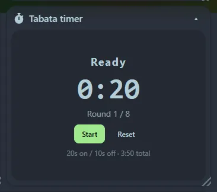

A classic interval timer.

## Settings

- **Get-ready** seconds before the first round (0 to skip).
- **Work** seconds and **rest** seconds per round.
- **Rounds**.
- **Beeps**: a short beep for the last seconds of each phase and a longer one at each change.

## Using it

**Start**, **Pause** and **Reset**. The background changes colour for each phase (get ready, work, rest, done) and the tile shows the current round and the time left. The defaults are the classic 20 seconds on, 10 off, 8 rounds.

Beeps are played by your browser, so click **Start** at least once (browsers only allow sound after a click).
