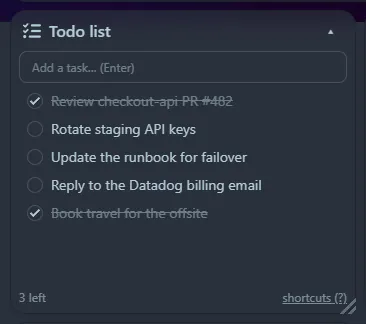

A simple list with a box for new items. Click the list (or <kbd>Tab</kbd> into it) and use the keyboard:

| Key | Action |
|---|---|
| <kbd>n</kbd> | New item |
| <kbd>↑</kbd> <kbd>↓</kbd> or <kbd>j</kbd> <kbd>k</kbd> | Move the selection |
| <kbd>Space</kbd> or <kbd>x</kbd> | Toggle done |
| <kbd>e</kbd> or <kbd>Enter</kbd> | Edit the item |
| <kbd>d</kbd> or <kbd>Del</kbd> | Delete the item |
| <kbd>Shift</kbd>+<kbd>↑</kbd> <kbd>↓</kbd> | Reorder |
| <kbd>c</kbd> | Clear completed |
| <kbd>?</kbd> | Show the shortcuts in the tile |

Items are saved in the database as you change them.
