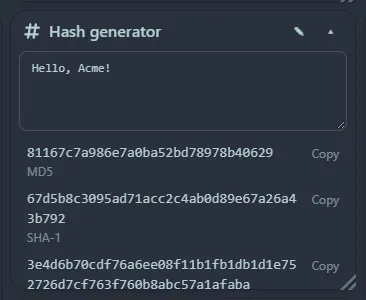
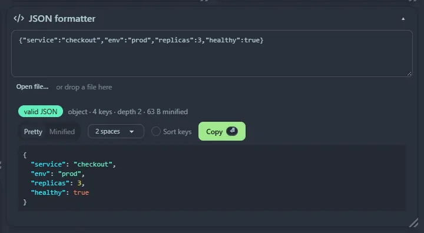

Every [launcher](/launcher/) tool is also a widget. A tool widget hosts the same engine as the launcher, with a **text box on top** and the **result below**. Click a result to copy it.

## The tool widgets

| Category | Widgets |
|---|---|
| Calculators and converters | [Calculator](/launcher/calculator/) · [Unit converter](/launcher/units/) · [Currency converter](/launcher/currency/) |
| Time | [Timestamp converter](/launcher/timestamp/) · [Cron explainer](/launcher/cron/) |
| Security and encoding | [Password generator](/launcher/password/) · [Hash generator](/launcher/hash/) · [Base64](/launcher/base64/) · [UUID generator](/launcher/uuid/) · [JWT decoder](/launcher/jwt/) |
| Developer tools | [Curl runner](/launcher/curl/) · [JSON formatter](/launcher/json/) · [Regex tester](/launcher/regex/) · [Text diff](/launcher/diff/) · [CSV ⇄ JSON](/launcher/csv/) |
| Media and design | [QR code generator](/launcher/qr/) · [Lorem ipsum](/launcher/lorem/) |
| Notes | [Markdown previewer](/launcher/markdown/) |

The colour tool is the separate [Colour picker widget](/widgets/colour-picker/).

## Good to know

- **Generators** (password, UUID, lorem ipsum) show results straight away and have a **↻** button to make new values.
- **What you type is not saved.** A tool box can contain tokens, JSON or commands, so it is empty after a reload.
- **Keyboard shortcuts** only apply while focus is inside that widget, and they use <kbd>Ctrl</kbd>+<kbd>Enter</kbd>, because plain <kbd>Enter</kbd> stays free for typing.
- Tools that need space, such as the regex tester and text diff, work best in a wide tile. Resize freely.
