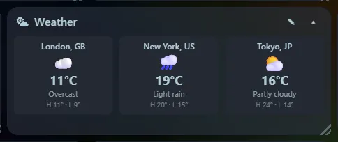
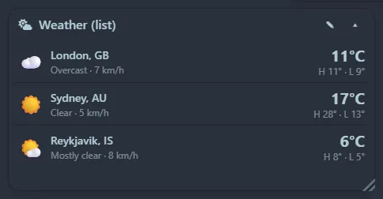

Current conditions and today's high and low for **one or more places in one tile**, always labelled with the location ("London, GB"). Data comes from [Open-Meteo](https://open-meteo.com), which needs no account or key.

## Settings

- **Places**: type city names. Each one is looked up when you save, so a typo is caught immediately.
- **Layout when there is more than one**: **List** or **Mini tiles**, as for the [clock](/widgets/clock/).
- **Celsius or Fahrenheit**.

Conditions refresh every 15 minutes. With a single place, the tile shows a large view with wind speed. The widget needs internet access; see [Privacy and security](/guides/privacy-and-security/).
